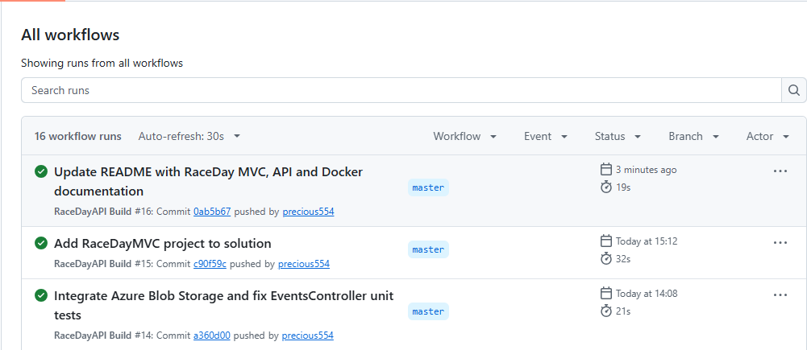

# RaceDay Event Management System

## Project Overview

RaceDay is a full-stack event management platform developed using ASP.NET Core and C#. It is designed for the South African road running, walking and cycling community.

The system allows organisers to create and manage sporting events while participants can browse events, enrol in categories, manage their profiles and view race results.

The solution consists of an ASP.NET Core Web API and an ASP.NET Core MVC web application.

## Technologies Used

- C#
- ASP.NET Core 8 Web API
- ASP.NET Core MVC
- Entity Framework Core
- SQL Server
- Swagger / OpenAPI
- JWT Authentication
- Session-based authentication
- Azure Blob Storage
- Docker
- xUnit
- GitHub Actions

## User Roles

### Organiser
- Create, view, update and delete events.
- Upload event banners.
- Create and manage event categories.
- View participant enrolments.
- Record race results.
- Manage event information.

### Participant
- Register and log in.
- Browse and search available events.
- View event details and banners.
- Enrol in event categories.
- View personal enrolments.
- Cancel enrolments.
- Update profile information.
- Upload a profile picture.
- View personal race results.

## Main Features

### Authentication and Security
- User registration and login.
- Organiser and Participant roles.
- Password hashing.
- JWT-based API authentication.
- Session-based MVC authentication.
- Role-based access controls.

### Event Management
- Event creation and management.
- Event category management.
- Event banner uploads.
- Event browsing and filtering.

### Participant Management
- Participant enrolments.
- Enrolment management.
- Profile updates.
- Profile picture uploads.

### Race Results
- Organisers can record participant results.
- Participants can view their results.
- Results include finishing position, finish time and status.

### Azure Blob Storage
Azure Blob Storage is used to store event banners and participant profile pictures.

### API Documentation
Swagger / OpenAPI provides documentation and testing functionality for the REST API endpoints.

## Project Structure

```text
RaceDay/
│
├── RaceDayAPI/
│   ├── Controllers/
│   ├── Data/
│   ├── DTOs/
│   ├── Models/
│   ├── Services/
│   └── Dockerfile
│
├── RaceDayMVC/
│   ├── Controllers/
│   ├── Models/
│   ├── Views/
│   └── Dockerfile
│
├── RaceDayAPI.Tests/
│
├── .github/
│   └── workflows/
│
├── RaceDayAPI.sln
└── README.md
```

## Getting Started

### Prerequisites

Install the following:

- .NET 8 SDK
- Visual Studio 2022 or a compatible IDE
- SQL Server
- Docker Desktop

### Setup Instructions

1. Clone or download the repository.
2. Open `RaceDayAPI.sln` in Visual Studio.
3. Configure the SQL Server connection string.
4. Configure the required Azure Blob Storage settings.
5. Restore NuGet packages.
6. Build the solution.
7. Run the API and MVC projects.
8. Access the MVC application using the URL displayed by Visual Studio.
9. Access the API documentation through the Swagger URL.

### Running Unit Tests

In Visual Studio:

1. Open Test Explorer.
2. Select Run All Tests.
3. Confirm that the tests pass.

Alternatively, run the following commands from the solution folder:

```bash
dotnet restore
dotnet build
dotnet test
```

## Docker

Dockerfiles are included for both the API and MVC projects.

Build the API image:

```bash
docker build -f RaceDayAPI/Dockerfile -t raceday-api .
```

Build the MVC image:

```bash
docker build -f RaceDayMVC/Dockerfile -t raceday-mvc .
```

Run the API container:

```bash
docker run --rm -p 8080:8080 --name raceday-api raceday-api:latest
```

**Important:** The container requires a reachable SQL Server database and the required application configuration. A Windows LocalDB instance is not directly accessible from a Linux container. Configure the database connection and Azure settings before running the application in Docker.

The API and MVC Docker images have been built successfully.

## Continuous Integration

GitHub Actions is used to build and validate the solution.

The workflow is located in:

`.github/workflows/dotnet.yml`

To view build results, open the Actions tab in the GitHub repository.

## Successful Build Evidence

Add a screenshot of the successful GitHub Actions workflow here.



## Project Demonstration

Video demonstration: [Insert your video link here]

## Repository

GitHub Repository:

https://github.com/precious554/RaceDayAPI